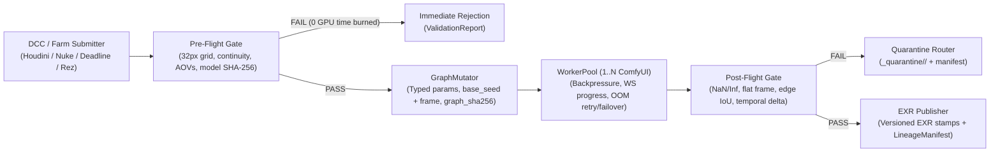
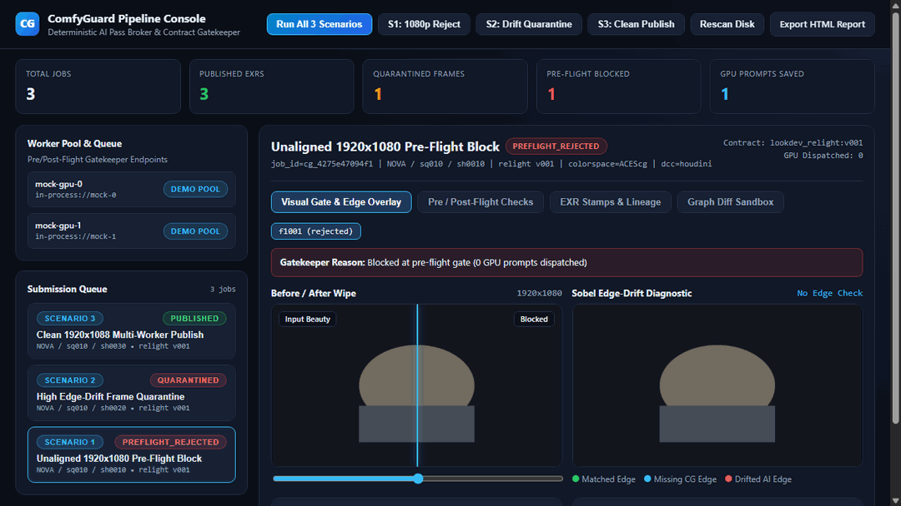
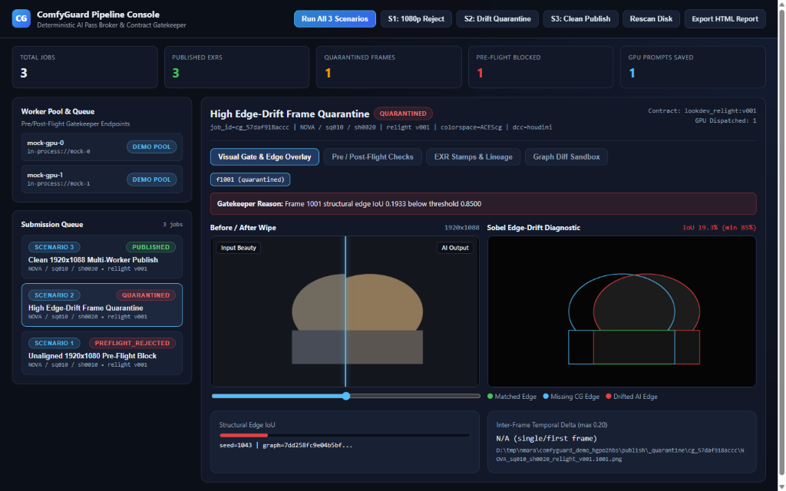
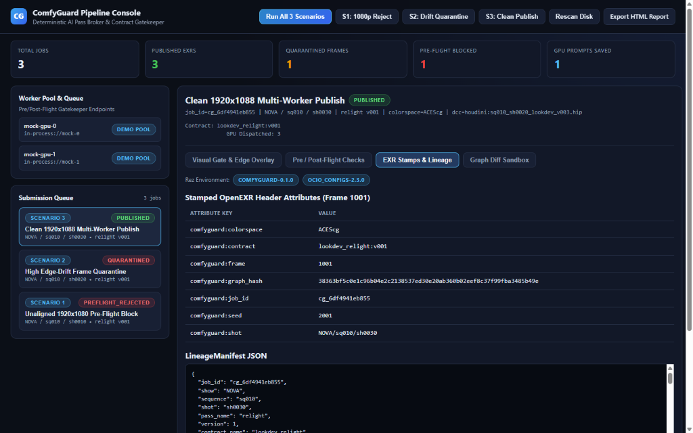

# ComfyGuard

[](https://github.com/nmaragos/comfyguard/actions/workflows/ci.yml)
[](https://nmaragos.github.io/comfyguard/)


**Deterministic ComfyUI Pipeline Broker & Contract Gatekeeper for VFX**

> **[Open the Live Interactive Demo Console →](https://nmaragos.github.io/comfyguard/)** (hosted on GitHub Pages, rebuilt automatically on every CI run)

ComfyGuard treats generative AI (ComfyUI) like an untrusted, non-deterministic render engine. Rather than artists manually running workflows and dropping PNGs into shot directories, ComfyGuard sits headlessly between DCC/farm submissions (Houdini, Nuke, Maya, Deadline, Rez) and ComfyUI workers—enforcing strict pre-flight contracts, typed graph mutation, post-flight buffer/edge/temporal checks, OpenEXR metadata provenance, and automatic frame quarantine.

## Architecture



## Core Capabilities

- **Typed Workflow Contracts (`contracts/schema.py`, `contracts/manifest.py`)**: YAML-defined schemas (`WorkflowContract`) binding ComfyUI node inputs to strict `int`/`float`/`bool`/`enum`/`file_path` types, min/max bounds, resolution grid rules, required AOVs, and checkpoint SHA-256 digests.
- **Deterministic Graph Mutation & Diffing (`broker/mutator.py`)**: Injects per-frame seeds (`base_seed + frame`), expanded sequence paths (`####`, `%0Nd`, `{frame:0Nd}`), and versioned output prefixes; computes canonical `graph_sha256` digests and structural `graph_diff(v1, v2)` reports for supervisors.
- **Pre-Flight Gate (`validation/preflight.py`)**: Inspects OpenEXR/PNG headers (using OpenImageIO when available, with pure-Python EXR/PNG and Pillow fallback) to catch unaligned resolutions (e.g., `1920x1080` vs 32px grid), missing/empty frames, missing AOV channels, missing `/object_info` models, and checkpoint hash mismatches before touching a GPU.
- **Resilient Async Broker (`broker/client.py`, `broker/pool.py`, `broker/smoke.py`)**: Streams ComfyUI WebSocket events (`executing`, `progress`, `executed`, `execution_error`, `execution_interrupted`), supports mid-run `/interrupt` cancellation and timeouts, enforces bounded queue backpressure, retries CUDA OOM failures across healthy workers with exponential backoff, and probes/smoke-tests live ComfyUI Desktop (`:8000`) or standalone (`:8188`) workers.
- **Post-Flight Gate & EXR Publisher (`validation/postflight.py`, `publish/publisher.py`, `publish/exr_io.py`)**: Checks output resolution/channels, NaN/Inf/flat buffers, structural Sobel edge IoU against reference depth/matte passes, and inter-frame temporal delta. Approved frames publish as versioned `.exr` sequences stamped with `comfyguard:graph_hash`, `comfyguard:seed`, and `comfyguard:colorspace` plus `lineage_manifest.json`; failures isolate automatically into `_quarantine/<job_id>/`.
- **DCC/Farm Hooks, Input Staging, Rez Package & CLI (`dcc/`, `package.py`, `cli.py`)**: Exposes `comfyguard` via Typer CLI (`validate`, `submit --upload-inputs`, `smoke-test`, `worker-status`, `diff`, `inspect`, `ui`), Foundry Nuke (`dcc/nuke_hook.py` Read-node builder & menu hooks), SideFX Houdini (`dcc/houdini_hook.py` HDA/ROP & TOPs/PDG hooks), Deadline job-info generation, and Rez environment hooks.

## Quickstart

```powershell
# Install dependencies in an isolated uv environment
uv sync

# Run the full test suite (offline mock HTTP/WebSocket ComfyUI servers)
uv run pytest -v

# Run the 3-scenario end-to-end portfolio demonstration
uv run python demo/run_portfolio_demo.py

# Export a self-contained visual HTML report (with embedded Before/After + Sobel Edge Overlays)
uv run python demo/run_portfolio_demo.py --report demo_report.html

# Launch the interactive dark-mode web console pre-loaded with all 3 scenarios
uv run comfyguard ui --demo

# Record an animated showcase GIF of `comfyguard ui --demo` for docs / LinkedIn
uv run python demo/capture_showcase.py --output docs/images/comfyguard_demo_showcase.gif

# Lint codebase
uv run ruff check src tests demo package.py
```

## Visual Dashboard & HTML Report

- **Online Demo**: [https://nmaragos.github.io/comfyguard/](https://nmaragos.github.io/comfyguard/) — Live interactive console deployed automatically via GitHub Pages.
- **`comfyguard ui --demo`** launches the local studio dashboard (`http://127.0.0.1:8788`) featuring:
  - **Live Scenario Runner & Worker Pool Monitor**: Trigger Scenario 1 (`1920x1080` pre-flight block), Scenario 2 (edge-drift quarantine), and Scenario 3 (2-worker clean EXR publish) on demand, or inspect real published/quarantined shot folders via `--root <dir>`.
  - **Before/After Wipe & Sobel Edge-Drift Diagnostic**: Interactive comparison slider paired with color-coded Sobel edge overlays (green = matched geometry, cyan = missing CG edge, red = drifted AI edge) and IoU / temporal delta meters.
  - **EXR Stamps & Graph Diff Sandbox**: View stamped `comfyguard:*` OpenEXR header attributes, `LineageManifest` JSON, and interactively test contract-validated `graph_diff` overrides.
- **`demo/run_portfolio_demo.py --report <file.html>`** generates a single offline, self-contained HTML visual report with embedded PNG previews and diagnostic overlays.

### Console Preview

**Interactive Console Walkthrough (`comfyguard ui --demo` — Pre-Flight Block → Sobel Drift Wipe → EXR Lineage → Graph Diff Sandbox):**


**Post-Flight Sobel Edge-Drift Quarantine (Scenario 2 — `IoU 19.3% < 85%`):**


**Stamped OpenEXR Header Provenance & `LineageManifest` (Scenario 3 — `1920x1088` Published EXRs):**


## CLI Examples

```powershell
# Auto-probe local ComfyUI (:8188) or ComfyUI Desktop (:8000) and list installed checkpoints
comfyguard worker-status

# Verify live worker readiness and checkpoint availability without dispatching GPU work
comfyguard smoke-test --check-only

# Run an end-to-end live img2img smoke test (/upload/image -> KSampler -> post-flight -> stamped EXR)
comfyguard smoke-test --width 512 --height 512 --steps 4 --denoise 0.15

# Inspect structural & parameter changes between workflow versions
comfyguard diff workflows/lookdev_relight_v001/workflow_api.json updated_workflow_api.json

# Validate a shot submission without dispatching GPU work
comfyguard validate --job shot_job.json --endpoint http://127.0.0.1:8188

# Submit a job across two ComfyUI workers, staging local plates via POST /upload/image
comfyguard submit --job shot_job.json --upload-inputs --endpoint http://gpu01:8188 --endpoint http://gpu02:8188

# Inspect EXR provenance stamps or a lineage manifest
comfyguard inspect publish/NOVA/sq010/sh0030/relight/v001/NOVA_sq010_sh0030_relight_v001.1001.exr
comfyguard inspect publish/NOVA/sq010/sh0030/relight/v001/lineage_manifest.json
```

## DCC Integration Hooks (Nuke & Houdini)

- **Foundry Nuke (`src/comfyguard/dcc/nuke_hook.py`)**: Extracts `%04d` / `####` Read-node patterns without expanding frame tokens, captures OCIO/script context, builds `ComfyGuardSubmit` NoOp knobs and Nodes menu entries (`register_nuke_menu`), submits directly or to Deadline, and spawns a `Read` node (`%04d.exr`, `ACEScg`) only when post-flight passes.
- **SideFX Houdini & TOPs/PDG (`src/comfyguard/dcc/houdini_hook.py`)**: Expands `$HIP`/`$JOB` while preserving `$F4`/`$F` tokens (`normalize_houdini_frame_pattern`), reads ROP `trange`/`f1..f3` or PDG work-item attributes (`build_job_from_pdg_work_item`), writes `$F4.exr` status back to HDA parms, and supports direct or Deadline farm export.

## Project Layout

```text
comfyguard/
├── package.py                      # Rez package definition
├── pyproject.toml                  # uv / pytest / ruff config
├── src/comfyguard/
│   ├── contracts/                  # WorkflowContract, JobRequest, LineageManifest
│   ├── broker/                     # Async client, WorkerPool, GraphMutator, graph_diff, smoke
│   ├── validation/                 # Pre-flight & post-flight gates
│   ├── publish/                    # OpenEXR adapter, metadata stamping, quarantine
│   ├── dcc/                        # Submitter, Nuke hook, Houdini/PDG hook, Deadline wrapper
│   └── cli.py                      # Typer CLI
├── workflows/lookdev_relight_v001/ # Sample SDXL + Depth ControlNet contract & API graph
├── tests/                          # Offline unit & async mock-server/mock-DCC test suite
└── demo/
    ├── run_portfolio_demo.py       # 3-scenario end-to-end showcase + static HTML report
    └── capture_showcase.py         # Automated headless CDP animated GIF/MP4 showcase recorder
```
